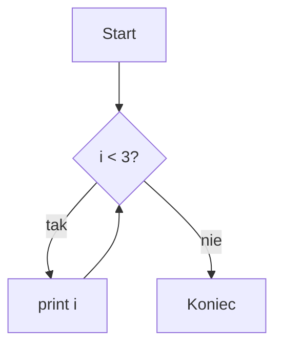

# Podstawy programowania w Pythonie

Ten skrypt towarzyszy zajęciom z pierwszego semestru. Przed pierwszymi zajęciami
zainstaluj Pythona w wersji 3.12 lub nowszej. Szczegóły znajdziesz w [dokumentacji][py].

## Zmienne i typy {#zmienne}

### Zmienne

Zmienna to nazwa wskazująca na wartość w pamięci.

```python
wiek = 20
imie = "Ola"
print(imie, wiek)
```

***

Nazwy zmiennych zapisujemy małymi literami, a słowa łączymy znakiem `_`.

| Typ     | Przykład  | Opis                |
| ------- | --------- | ------------------- |
| `int`   | `42`      | liczba całkowita    |
| `float` | `3.14`    | liczba rzeczywista  |
| `str`   | `"tekst"` | ciąg znaków         |

### Typy liczbowe

Pole koła obliczamy ze wzoru $S = \pi r^2$. Wzór na pierwiastki równania kwadratowego:

$$
x_{1,2} = \frac{-b \pm \sqrt{b^2 - 4ac}}{2a}
$$

## Pętle

### Pętla for

Pętla `for` wykonuje instrukcje dla każdego elementu sekwencji.

```python
for i in range(3):
    print(i)
```

> Uwaga: `range(3)` zaczyna od 0 i kończy przed 3.

### Schemat działania



***

Na tym kończymy część o pętlach.

[py]: https://docs.python.org/3/ "Dokumentacja Pythona"
